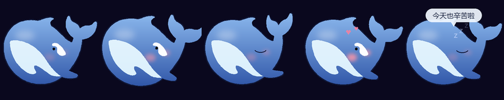
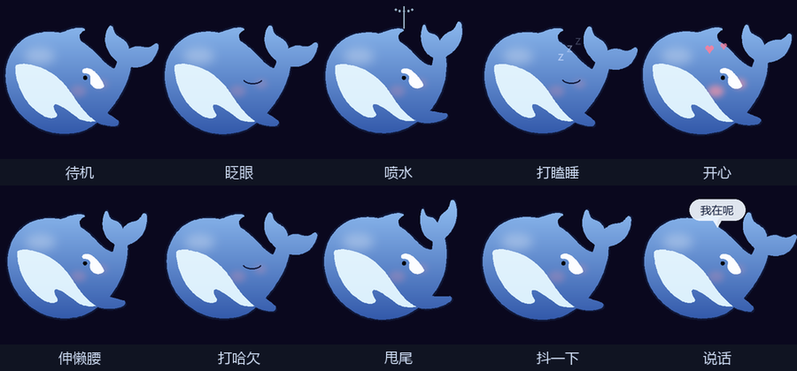

# 鲸鱼桌宠

一只住在屏幕角落的小鲸鱼。

轮廓不是贴的图——是从 DeepSeek 官方 logo 的矢量路径里逐点解析重绘的，
放大缩小都不糊，尾巴摆动时也是真的在变形。



## 跑起来

需要 **Windows** + **Python 3.8 或更高**。程序用了 Win32 的透明窗口、全屏检测和鼠标轮询，
Mac 和 Linux 上跑不了。

```bash
git clone https://github.com/DUDUDU1025/ds-whale-pet.git
cd ds-whale-pet
pip install pillow
python src/whale_pet.py
```

启动后会出现在屏幕**右下角**。想先看它长什么样、但不想开窗口：

```bash
python src/whale_pet.py --preview
```

只用 Pillow 一个依赖。不联网，不要账号，也不读你的文件——唯一的写入是
`data/.whale_state.json`（认识天数、摸头次数、喂食次数）。

### 常见问题

**双击没反应？**
用 `pythonw.exe` 启动就不会弹黑框，但出错也就看不到。装个 `python.exe` 跑一遍看报错。

**它不见了？**
拖到屏幕边缘外会自动拽回来；如果整扇窗都在屏幕外，等一秒它会自己归位。
真找不到了就删掉 `data/.whale_state.json` 里的 `pos` 字段重启。

**想开机自启？**
把 `pythonw.exe "完整路径\src\whale_pet.py"` 的快捷方式丢进
`%APPDATA%\Microsoft\Windows\Start Menu\Programs\Startup`。
程序内置单实例互斥体，开机自启和手动启动撞一起也只会有一只。

**嫌费电？**
改 `src/whale_pet.py` 顶部的 `TARGET_FRAME_MS`（默认 24 → 约 42fps），
或者 `S`（超采样倍率，2 → 1 能省一半 CPU，代价是边缘有锯齿）。
空闲 15 秒会自动降到 12fps，单核占用约 8%。

## 它会做什么

- 呼吸浮动、甩尾巴、偶尔喷水、随机眨眼
- 眼睛跟着鼠标转，凑近了会害羞
- 点一下蹦起来，双击跳更高，按住能拖着走
- 30 秒没互动就趴下打瞌睡，开始说梦话
- **喂鱼**：右键叼起一条小鱼，鱼跟着光标跑，左键放下，它会游过去吃掉
- 记得认识多少天、被摸过几次、喂过多少条
- 切到全屏游戏时会自动躲开

## 动作图鉴



## 文档

| 文件 | 内容 |
|---|---|
| [docs/GUIDE.md](docs/GUIDE.md) | **新手向导**。从装 Python 开始，一步步到能跑起来。不需要懂编程 |
| [docs/MANUAL.md](docs/MANUAL.md) | **完整手册**。前半部分讲怎么玩（交互、喂鱼、好感度、说话规则、配置），后半部分讲怎么实现的（渲染管线、代码结构、踩过的五个坑） |
| [docs/DISCLAIMER.md](docs/DISCLAIMER.md) | 免责声明：商标、图形版权、隐私、担保 |
| [LICENSE](LICENSE) | MIT |

## 致谢

鲸鱼轮廓出自 [deepseek-harness](https://github.com/deepseek-ai/deepseek-harness) 的
`BrandWordmark.tsx`。**图形是 DeepSeek 的品牌资产，版权归 DeepSeek 所有**，
本项目与官方无关，使用前请阅读 [docs/DISCLAIMER.md](docs/DISCLAIMER.md)。
